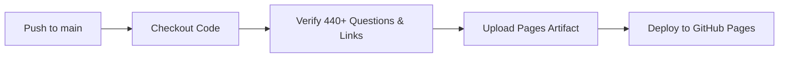

# Ajay Singh Pundir - Portfolio & Technical Interview Prep Hub

[](https://ajaypundir04.github.io/aj-profile/)
[](https://ajaypundir04.github.io/aj-profile/blog/)
[](https://linkedin.com/in/ajaysinghpundir)

> **Live Profile & Engineering Hub:** [ajaypundir04.github.io/aj-profile](https://ajaypundir04.github.io/aj-profile/)  
> **Resume:** [Download PDF](resume_ajay_pundir.pdf)  
> **Location:** Berlin, Germany • [Email](mailto:ajaysinghpundir70@gmail.com) • [LinkedIn](https://linkedin.com/in/ajaysinghpundir) • [GitHub](https://github.com/ajaypundir04)

---

## 📌 Overview

This repository hosts the personal portfolio website and comprehensive technical interview preparation blog for **Ajay Singh Pundir**, Technical Lead with 12+ years of security-focused backend engineering across banking, automotive, and fintech (currently leading Authentication & Authorization at **Elli - Volkswagen Charging GmbH**; M.Sc. in Data Science from the **University of Münster**).

The repository is built with vanilla HTML5, modern CSS3, and responsive JavaScript, specifically designed for zero-build, zero-dependency deployment on **GitHub Pages**.

---

## 🚀 The 4 Interview Tracks (440+ Questions Total)

The embedded technical blog includes **110+ comprehensive, architect-level questions & solutions per track**:

| Track | Questions | Core Topics & Patterns | Dedicated Page |
|---|---|---|---|
| **⚡ Data Structures & Algorithms** | **110** | Arrays & Hashing, Two Pointers, Sliding Window, Monotonic Stacks, Binary Search on Answer, Trees/BST, Tries, Heaps, BFS/DFS, Topological Sort, Dijkstra, 1D/2D DP, Backtracking, Bit Manipulation | [`blog/dsa.html`](blog/dsa.html) |
| **🏗️ System Design & Architecture** | **110** | CAP & PACELC, Distributed Consensus (Raft/Paxos), Vector Clocks, Consistent Hashing, L4/L7 Balancing, B-Tree vs LSM, Sharding, Outbox Pattern, Kafka, Debezium CDC, Rate Limiters, EV Charging, Payment Ledgers | [`blog/system-design.html`](blog/system-design.html) |
| **🛡️ Security & Identity (IAM)** | **110** | OAuth 2.0 & OIDC, PKCE, Refresh Token Rotation, JWT Attacks (`alg:none`, key confusion), JWKS, Auth0 Actions, k-Anonymity Breached Password Checks, Passkeys/WebAuthn, RBAC/ABAC, OWASP Top 10, Zero Trust | [`blog/security.html`](blog/security.html) |
| **🧠 AI & Machine Learning** | **110** | Scaled Dot-Product Attention, RoPE, RMSNorm, GQA, FlashAttention, Chinchilla Scaling, MoE, LoRA/QLoRA PEFT, SFT Masked Loss, DPO vs RLHF, Advanced RAG, HNSW Vector Indexing, Multilingual Sentiment Analysis | [`blog/ai.html`](blog/ai.html) |

### ✨ Interactive Hub Features
- 🔍 **Real-Time Client-Side Search:** Instant multi-field search across titles, problem prompts, in-depth technical explanations, and tags.
- 🏷️ **Multi-Dimensional Filters:** Filter dynamically by Category, Track, Difficulty (Easy, Medium, Hard), and Review Status.
- 📊 **Progress Tracker:** Persists reviewed questions in browser `localStorage`, calculating progress percentages in real time.
- 🔗 **Deep-Linking:** Every question card supports direct URL anchors (e.g. `blog/#sec-12`), automatically expanding and centering the card upon arrival.
- 🌓 **Dark / Light Theme:** Custom CSS design system with automatic preference detection and manual toggle.

---

## 📂 Repository Structure

```text
.
├── index.html                   # Portfolio & Profile Page (Based on Resume)
├── resume_ajay_pundir.pdf       # Original Resume PDF
├── .nojekyll                    # Ensures GitHub Pages serves all assets directly
├── README.md                    # Project documentation
├── blog/
│   ├── index.html               # Unified Interview Prep Hub (All 440+ Qs)
│   ├── dsa.html                 # Dedicated DSA Track (110 Qs)
│   ├── system-design.html       # Dedicated System Design Track (110 Qs)
│   ├── security.html            # Dedicated Security & IAM Track (110 Qs)
│   └── ai.html                  # Dedicated AI & Machine Learning Track (110 Qs)
├── assets/
│   ├── css/
│   │   ├── style.css            # Design system, variables, layout, typography
│   │   └── blog.css             # Question cards, accordion, search, progress tracker
│   ├── js/
│   │   ├── main.js              # Theme manager, mobile menu, scroll utilities
│   │   ├── blog.js              # Search engine, filter dispatcher, progress storage
│   │   └── data/
│   │       ├── dsa.js           # 110 DSA interview questions data
│   │       ├── system-design.js # 110 System Design interview questions data
│   │       ├── security.js      # 110 Security & IAM interview questions data
│   │       └── ai.js            # 110 AI & ML interview questions data
│   └── resume_ajay_pundir.pdf   # Static asset copy of resume
└── scripts/
    ├── generate_dsa.py          # Generator for DSA dataset
    ├── build_system_design.py   # Generator for System Design dataset
    ├── build_security.py        # Generator for Security dataset
    └── build_ai.py              # Generator for AI & Machine Learning dataset
```

---

## 🛠️ Automated CI/CD Deployment with GitHub Actions

This repository is configured with an automated **GitHub Actions** workflow ([`.github/workflows/deploy.yml`](.github/workflows/deploy.yml)):



### 1. Push to GitHub
```bash
git add .
git commit -m "feat: complete profile page, 4-track interview prep hub, and GitHub Actions CI/CD"
git branch -M main
git remote add origin https://github.com/ajaypundir04/<repo-name>.git
git push -u origin main
```

### 2. Configure GitHub Pages to use GitHub Actions
1. Open your repository on GitHub.
2. Go to **Settings** → **Pages** (in the left sidebar).
3. Under **Build and deployment**:
   - In the **Source** dropdown, select **GitHub Actions**.
4. That's it! GitHub will now trigger your `.github/workflows/deploy.yml` workflow automatically on every push to `main`.
5. You can view the live progress under the **Actions** tab. Once completed, your site will be live at:
   `https://ajaypundir04.github.io/<repo-name>/`

---

## 💻 Local Development & Testing

Because the project uses standard static web assets with zero build steps or npm dependencies, you can run and test it locally with any simple HTTP server:

```bash
# Using Python 3 built-in HTTP server:
python3 -m http.server 8000
```

Then open your browser at [http://localhost:8000](http://localhost:8000).

---

## 👤 About Ajay Singh Pundir

- **Current Role:** Technical Lead at Elli - Volkswagen Charging GmbH
- **Focus Areas:** IAM & Authentication Platforms, OAuth2 / OIDC, Zero Trust, Cloud-Native Distributed Systems, Big Data Pipelines, and Applied LLM Research.
- **Education:** M.Sc. in Data Science (University of Münster, 2025) • B.Tech. in Computer Science (UTU, 2013).
- **Contact:** [ajaysinghpundir70@gmail.com](mailto:ajaysinghpundir70@gmail.com) • [LinkedIn](https://linkedin.com/in/ajaysinghpundir)
